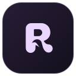
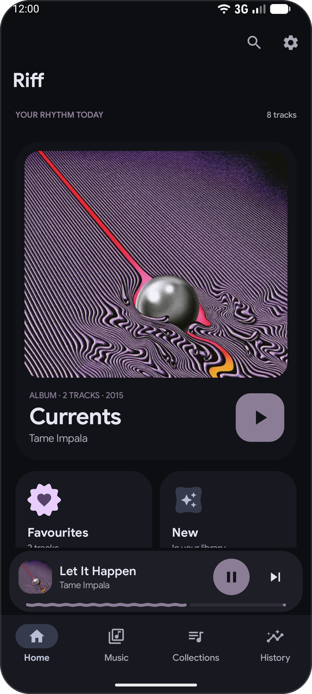
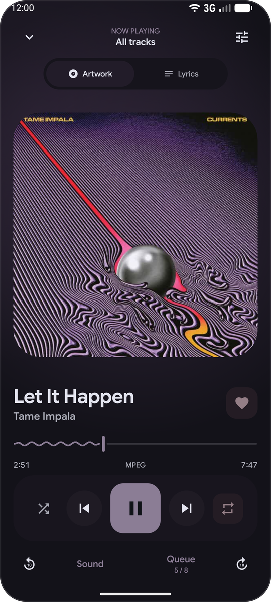
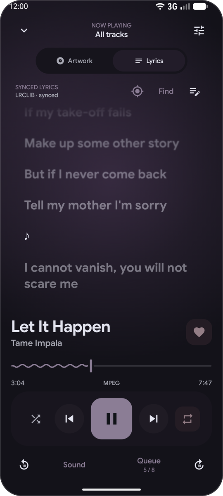
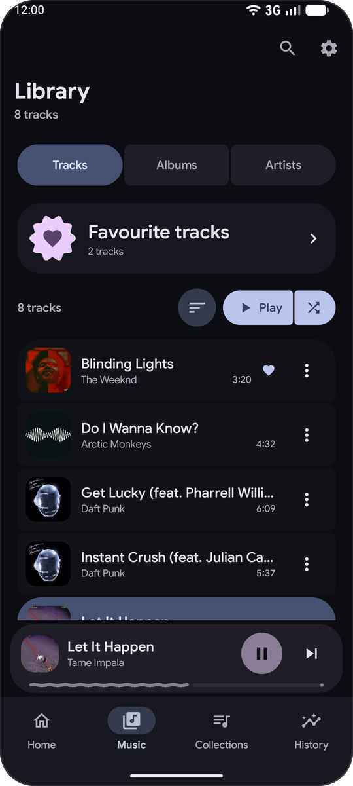
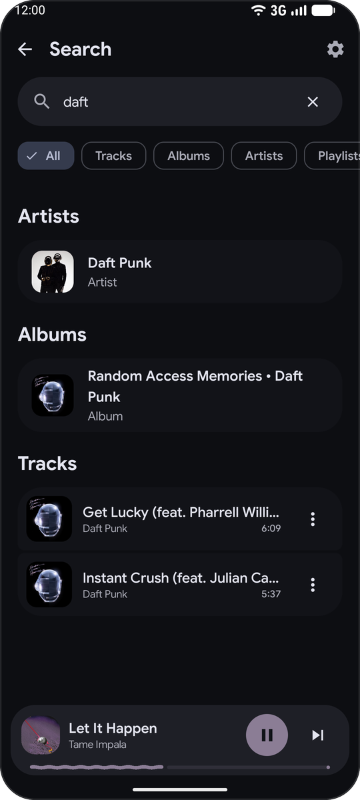
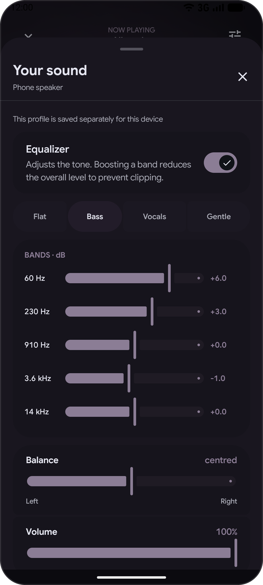

<div align="center">



# Riff

Локальный аудиоплеер для Android в стиле Material 3 Expressive  
Offline Android music player built with Material 3 Expressive

<p>
  <a href="https://github.com/emeraldstar1337/Riff/releases/latest">
    
  </a>
  <a href="https://github.com/emeraldstar1337/Riff/releases">
    
  </a>
  
  
  <a href="LICENSE">
    
  </a>
</p>

<p>
  <a href="#скриншоты--screenshots">Скриншоты</a> ·
  <a href="#о-приложении">Русский</a> ·
  <a href="#overview">English</a> ·
  <a href="https://github.com/emeraldstar1337/Riff/releases/latest">Скачать APK</a>
</p>

</div>

---

## Скриншоты / Screenshots

<div align="center">
<table>
  <tr>
    <td align="center" width="33%">
      <br />
      <sub><b>Home</b></sub>
    </td>
    <td align="center" width="33%">
      <br />
      <sub><b>Now Playing</b></sub>
    </td>
    <td align="center" width="33%">
      <br />
      <sub><b>Synced Lyrics</b></sub>
    </td>
  </tr>
  <tr>
    <td align="center" width="33%">
      <br />
      <sub><b>Library</b></sub>
    </td>
    <td align="center" width="33%">
      <br />
      <sub><b>Search</b></sub>
    </td>
    <td align="center" width="33%">
      <br />
      <sub><b>Sound & Equalizer</b></sub>
    </td>
  </tr>
</table>
</div>

---

## О приложении

Riff воспроизводит локальную медиатеку на Android без аккаунтов, рекламы и подписок. Интерфейс построен на Jetpack Compose и Material 3 Expressive: списки сгруппированы в сегментированные карточки, цвета плеера автоматически подбираются в триаде под обложку текущего трека, а переходы и нажатия работают на пружинной физике.

### Основные возможности

| Раздел | Что доступно |
| --- | --- |
| Медиатека и поиск | Треки, альбомы, исполнители, плейлисты и избранное. Умная группировка артистов распознаёт регистр и фиты (`feat.`, `ft.`, `&`), а быстрый поиск фильтрует результаты по категориям. |
| Плеер | Динамическая палитра по обложке, волнистый и прямой прогресс-бар в четырёх вариантах, живой морфинг кнопки воспроизведения и паузы, редактируемая очередь, повтор и кроссфейд. |
| Тексты песен | Синхронизированные тексты с подсветкой текущей строки, поиском через LRCLIB и отдельной настройкой размера, выравнивания и яркости. |
| Оформление | Светлая и тёмная темы, системные цвета Monet, пользовательские палитры, формы обложек, выбор стиля навигации (нижняя панель или плавающий док), порядок вкладок и адаптивный `NavigationRail` на широких экранах. |
| Звук | 5-полосный эквалайзер, баланс каналов и громкость с отдельными профилями под каждое подключённое устройство. |
| USB bit-perfect | Прямой вывод на совместимые USB-ЦАПы без пересэмплирования на Android 14+ с отображением активного формата (экспериментальный режим). |
| Статистика и Recap | История прослушиваний, топ треков и артистов, а также сезонные и годовые итоги. |
| Языки | Русский и английский, переключаются прямо в настройках. |

### Конфиденциальность и расход батареи

Аудиофайлы и история прослушиваний хранятся локально на устройстве. Поиск текстов через LRCLIB и загрузка фото артистов работают по запросу и передают только текстовые метаданные, без доступа к самим файлам. Визуализатор, анимированный фон и кроссфейд выключены по умолчанию, а на поддерживаемых устройствах используется аппаратный audio offload.

### Установка и сборка

Готовый подписанный APK доступен на странице [Releases](https://github.com/emeraldstar1337/Riff/releases/latest). Требуется Android 8.0 (API 26) или новее.

Чтобы собрать проект из исходников с помощью JDK 17 и Android SDK:

```bash
git clone https://github.com/emeraldstar1337/Riff.git
cd Riff
./gradlew :app:assembleRelease
```

---

## Overview

Riff plays your local music collection on Android without accounts, ads, or cloud lock-in. Built with Kotlin, Jetpack Compose, and Material 3 Expressive, the interface pairs segmented lists and collapsing top bars with a cover-derived dynamic color triad and spring-driven transitions.

### Features

| Area | Details |
| --- | --- |
| Library and search | Browse tracks, albums, artists, playlists, and favourites. Smart artist grouping handles case differences and collaboration credits (`feat.`, `ft.`, `&`), while search filters results by category. |
| Playback | Cover-tinted player themes, four seek bar styles (straight or wavy, circular or vertical handle), play/pause shape morphing, an editable queue, shuffle, repeat, and crossfade. |
| Synced lyrics | Time-synced active lines with LRCLIB lookup and per-screen controls for font size, alignment, spacing, and contrast. |
| Appearance | Light and dark themes, dynamic Monet colours, custom palettes, artwork shapes, switchable navigation bar or floating dock, custom tab order, and an adaptive `NavigationRail` on screens 600 dp and wider. |
| Sound | Five-band equalizer, channel balance, and volume profiles saved separately for each audio output device. |
| USB bit-perfect | Direct output to compatible USB DACs without resampling on Android 14 and later, showing active stream parameters (experimental beta). |
| Listening history | Local playback statistics, top tracks and artists, plus seasonal and yearly recaps. |
| Languages | English and Russian, selectable inside Settings. |

### Privacy and battery

Your audio files and listening history stay on your phone. Optional LRCLIB lyrics lookups and artist image fetches send only text metadata, never audio files. The visualizer, animated background, and crossfade start turned off, and supported devices use hardware audio offload to reduce battery drain.

### Installation and building

Download the signed APK from [Releases](https://github.com/emeraldstar1337/Riff/releases/latest). Riff runs on Android 8.0 (API 26) and later.

Build from source with JDK 17 and the Android SDK:

```bash
git clone https://github.com/emeraldstar1337/Riff.git
cd Riff
./gradlew :app:assembleRelease
```

### Stack and license

Riff uses Kotlin, Jetpack Compose, Material 3 Expressive, Media3 (ExoPlayer), Room, and Coil. Source code is distributed under the [MIT License](LICENSE).
